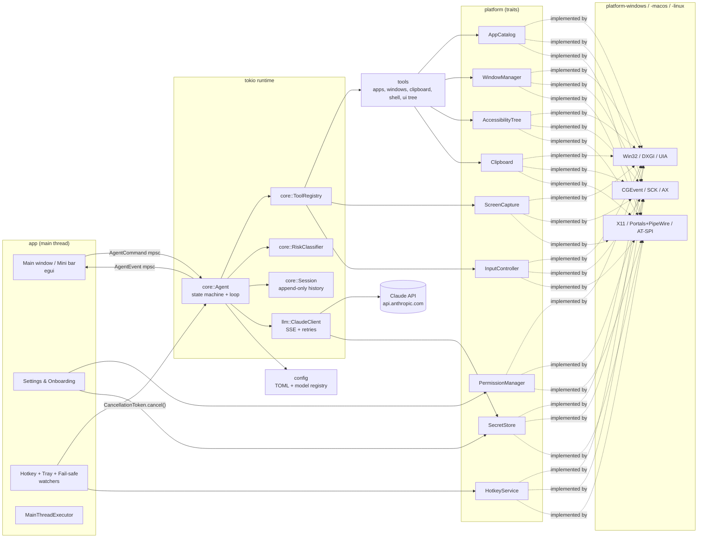
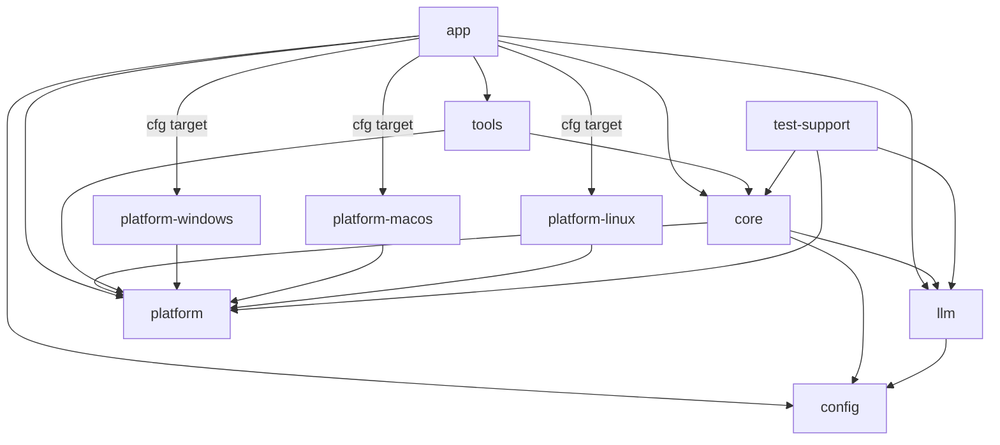
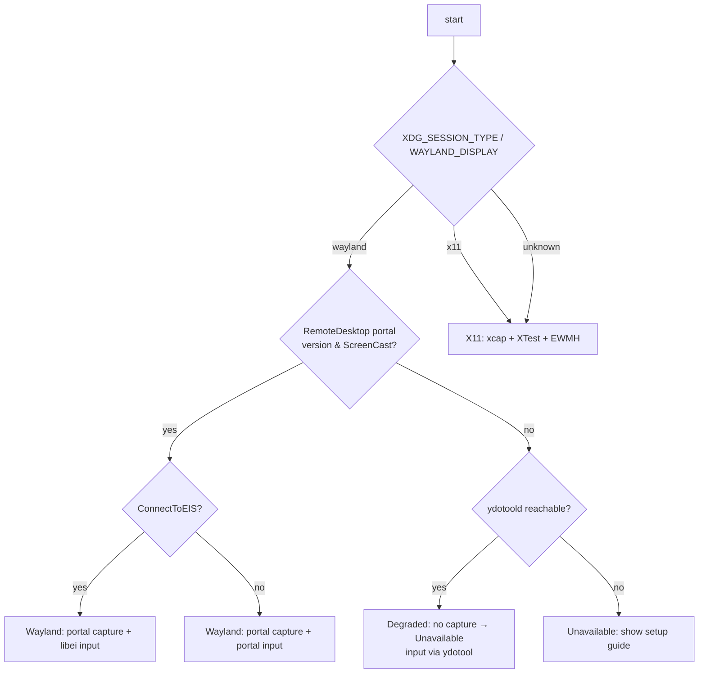
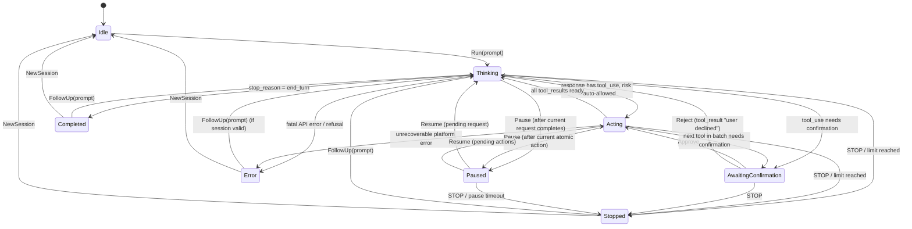
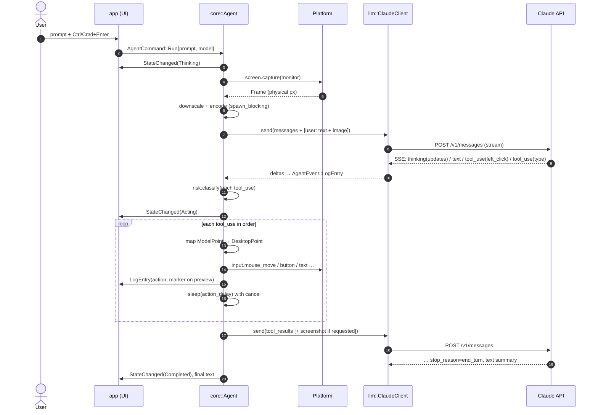
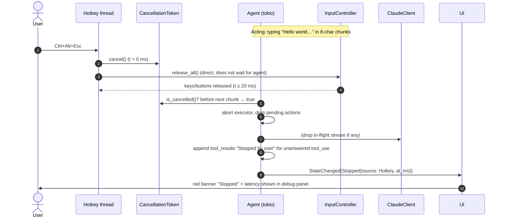
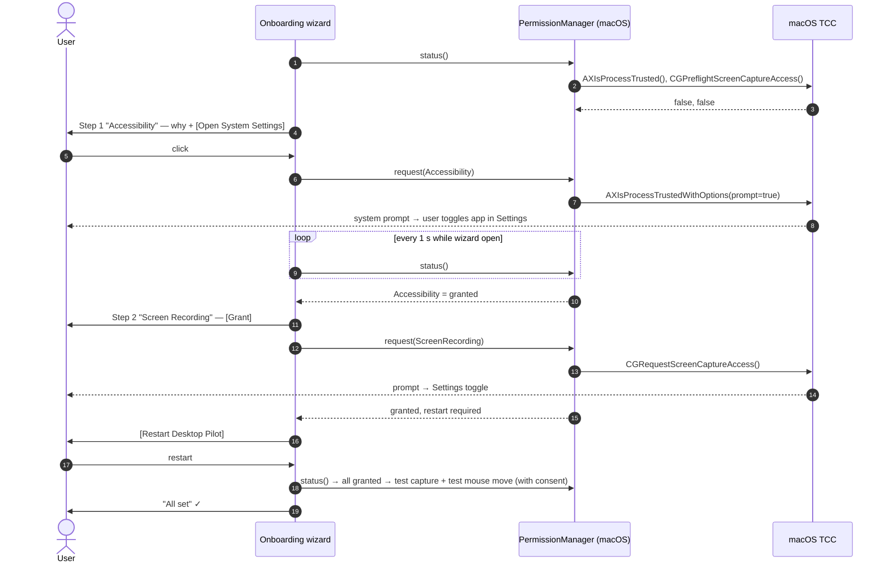
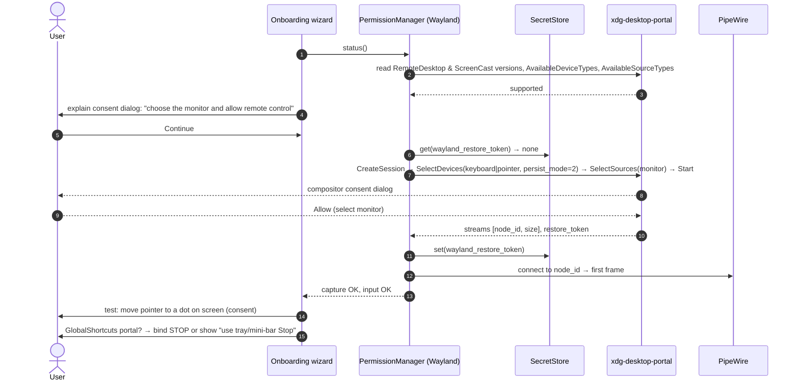
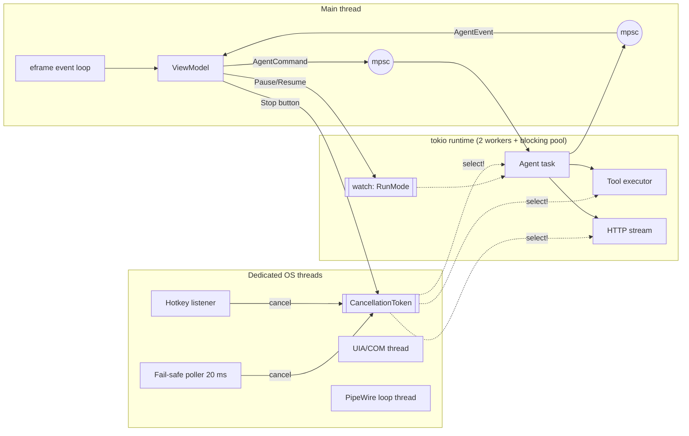
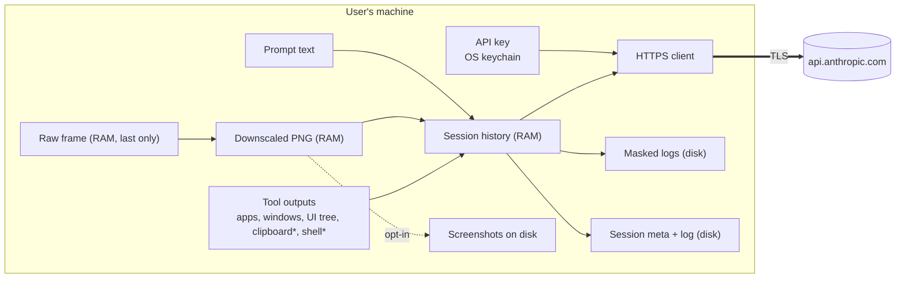

# Desktop Pilot — System Architecture

| Field | Value |
|---|---|
| Status | Draft v0.1, awaiting approval |
| Date | 2026-11-16 |
| Related | [TRD](TRD.md) · [SECURITY](SECURITY.md) · [ADR index](adr/README.md) |

---

## 1. High-level component diagram



The only component that talks to the network is `llm::ClaudeClient`. The only crates that call OS APIs are `platform-*`.

## 2. Workspace layout

Package names (decided at M0): directories keep the short names below, but packages are prefixed `dp-` (`dp-core`, `dp-llm`, `dp-platform`, `dp-platform-windows`, …) because a package named `core` would clash with Rust's built-in `core` crate. The binary package is `desktop-pilot`. A small `xtask` crate holds repository automation (`cargo xtask check-deps` enforces the dependency rules below).

```
desktop-pilot/
├─ Cargo.toml                 # [workspace], shared deps, lints, profile
├─ rust-toolchain.toml
├─ deny.toml
├─ crates/
│  ├─ app/                    # bin "desktop-pilot": eframe UI, wiring, hotkeys, tray
│  ├─ core/                   # agent loop, state machine, session, tool registry, risk, coords
│  ├─ llm/                    # Claude client, types, SSE parser, retries, model capabilities
│  ├─ platform/               # traits + shared types (Monitor, Frame, Key, Capability…)
│  ├─ platform-windows/       # cfg(target_os = "windows")
│  ├─ platform-macos/         # cfg(target_os = "macos")
│  ├─ platform-linux/         # cfg(target_os = "linux"): x11/ and wayland/ modules
│  ├─ tools/                  # custom tools built on platform traits
│  ├─ config/                 # settings, model registry, paths, secrets facade
│  └─ test-support/           # mock platform, mock Claude server (wiremock), fixtures
├─ docs/
└─ .github/workflows/
```

### Dependency rules (enforced by a CI script that parses `cargo metadata`)



- `core`, `llm`, `tools`, `config`, `platform` contain **no** `cfg(target_os)` code and no OS crates.
- Only `app` selects the platform implementation: `platform::Backend` is built by `app::platform_init()` behind `cfg`.
- `core` depends on `platform` traits only, so it is tested with `test-support::MockPlatform`.

| Crate | Owns | Must not |
|---|---|---|
| `app` | eframe app, views, view-models, hotkey/tray/fail-safe threads, onboarding, startup wiring, panic hook | Contain agent logic |
| `core` | `Agent`, `AgentStateMachine`, `Session`, `ToolRegistry`, `Tool` trait, `RiskClassifier`, `coords`, system prompt template, computer-toolset executor | Call OS APIs or HTTP directly |
| `llm` | `LlmProvider` trait, `ClaudeClient`, request/response types, SSE parser, `RetryPolicy`, `ModelCapabilities` | Know about screens or tools beyond JSON schemas |
| `platform` | Traits (§3), shared types, `Capability` / `CapabilityReport`, `PlatformError` | Have OS code |
| `platform-*` | Trait implementations, permission checks, backend selection (X11/Wayland) | Depend on `core`/`llm` |
| `tools` | `list_installed_apps`, `launch_app`, `list_open_windows`, `focus_window`, `get_ui_tree`, `read_clipboard`, `write_clipboard`, `run_shell_command` | Inject input directly (go through traits) |
| `config` | `Settings`, TOML load/save/migrate, `ModelRegistry`, paths, `SecretStore` facade over the trait | — |

## 3. Platform Abstraction Layer (PAL)

All traits are `Send + Sync`, object-safe, and `async` where they may block (implemented with native `async fn` in traits where object safety allows, else returning `BoxFuture`). Implementations run blocking OS calls on their own threads.

```rust
// crates/platform/src/lib.rs (sketch — final signatures settled in M2)

pub struct Platform {
    pub screen: Arc<dyn ScreenCapture>,
    pub input: Arc<dyn InputController>,
    pub apps: Arc<dyn AppCatalog>,
    pub windows: Arc<dyn WindowManager>,
    pub a11y: Arc<dyn AccessibilityTree>,
    pub hotkeys: Arc<dyn HotkeyService>,
    pub permissions: Arc<dyn PermissionManager>,
    pub secrets: Arc<dyn SecretStore>,
    pub clipboard: Arc<dyn Clipboard>,
    pub info: PlatformInfo,           // os, version, session type, desktop env
}

#[derive(Clone, Debug)]
pub struct MonitorInfo {
    pub id: MonitorId,
    pub name: String,
    pub origin_physical: (i32, i32),   // virtual desktop, physical px
    pub size_physical: (u32, u32),
    pub origin_logical: (f64, f64),    // OS global logical space
    pub scale_factor: f64,             // physical / logical
    pub is_primary: bool,
}

pub struct Frame {                      // raw capture of one monitor
    pub monitor: MonitorId,
    pub width: u32, pub height: u32,
    pub rgba: Arc<[u8]>,
    pub captured_at: Instant,
}

#[async_trait::async_trait] // or native async; decided in M2
pub trait ScreenCapture: Send + Sync {
    async fn monitors(&self) -> Result<Vec<MonitorInfo>, PlatformError>;
    async fn capture(&self, monitor: MonitorId) -> Result<Frame, PlatformError>;
    /// Exclude the given native window handles from captures if the OS allows it.
    fn exclude_windows(&self, handles: &[NativeWindowHandle]) -> ExclusionSupport;
    fn capability(&self) -> Capability;
}

pub enum CoordinateSpace { DesktopPhysical, DesktopLogical, StreamLogical { stream: MonitorId } }

#[async_trait::async_trait]
pub trait InputController: Send + Sync {
    fn coordinate_space(&self) -> CoordinateSpace;
    async fn mouse_move(&self, p: DesktopPoint) -> Result<(), PlatformError>;
    async fn button(&self, b: MouseButton, dir: Direction) -> Result<(), PlatformError>;
    async fn scroll(&self, dx: i32, dy: i32) -> Result<(), PlatformError>;
    async fn key(&self, key: Key, dir: Direction) -> Result<(), PlatformError>;
    async fn text(&self, chunk: &str) -> Result<(), PlatformError>;   // ≤ 8 chars per call
    async fn cursor_position(&self) -> Result<Option<DesktopPoint>, PlatformError>; // None on Wayland
    /// Release every key/button this controller pressed and has not released. Must not fail silently.
    fn release_all(&self) -> Result<(), PlatformError>;               // sync: callable from panic hook
    fn held_inputs(&self) -> HeldInputs;
    fn capability(&self) -> Capability;
}

#[async_trait::async_trait]
pub trait AppCatalog: Send + Sync {
    async fn list(&self, refresh: bool) -> Result<Vec<AppEntry>, PlatformError>;
    async fn launch(&self, app: &AppId, args: &[String]) -> Result<LaunchResult, PlatformError>;
}

#[async_trait::async_trait]
pub trait WindowManager: Send + Sync {
    async fn list(&self) -> Result<Vec<WindowInfo>, PlatformError>;   // title, app, pid, bounds, focused
    async fn focus(&self, id: &WindowId) -> Result<(), PlatformError>;
    async fn focused(&self) -> Result<Option<WindowInfo>, PlatformError>;
    fn capability(&self) -> Capability;
}

#[async_trait::async_trait]
pub trait AccessibilityTree: Send + Sync {
    async fn tree(&self, target: TreeTarget, limits: TreeLimits) -> Result<UiNode, PlatformError>;
    fn capability(&self) -> Capability;
}

pub trait HotkeyService: Send + Sync {
    /// Registers a global hotkey; callback runs on an OS thread and must be cheap (e.g. token.cancel()).
    fn register(&self, combo: HotkeyCombo, cb: Box<dyn Fn() + Send + Sync>) -> Result<HotkeyId, PlatformError>;
    fn unregister(&self, id: HotkeyId) -> Result<(), PlatformError>;
    fn capability(&self) -> Capability;
}

#[async_trait::async_trait]
pub trait PermissionManager: Send + Sync {
    async fn status(&self) -> Vec<PermissionStatus>;          // Accessibility, ScreenRecording, PortalSession, A11yBus…
    async fn request(&self, p: PermissionKind) -> Result<PermissionStatus, PlatformError>;
    fn settings_deep_link(&self, p: PermissionKind) -> Option<String>; // e.g. x-apple.systempreferences:…
}

pub trait SecretStore: Send + Sync {
    fn get(&self, key: SecretKey) -> Result<Option<SecretString>, PlatformError>;
    fn set(&self, key: SecretKey, value: &SecretString) -> Result<(), PlatformError>;
    fn delete(&self, key: SecretKey) -> Result<(), PlatformError>;
}

#[async_trait::async_trait]
pub trait Clipboard: Send + Sync {
    async fn read_text(&self) -> Result<Option<String>, PlatformError>;
    async fn write_text(&self, text: &str) -> Result<(), PlatformError>;
}

pub enum Capability {
    Available,
    Degraded { reason: String, workaround: Option<String> },
    Unavailable { reason: String, workaround: Option<String> },
}

#[derive(thiserror::Error, Debug)]
pub enum PlatformError {
    #[error("permission missing: {0:?}")] PermissionDenied(PermissionKind),
    #[error("not supported on this platform/session: {0}")] Unsupported(String),
    #[error("target not found: {0}")] NotFound(String),
    #[error("target window is elevated (admin)")] ElevatedTarget,
    #[error("secure desktop active")] SecureDesktop,
    #[error("portal: {0}")] Portal(String),
    #[error("cancelled")] Cancelled,
    #[error("os error: {0}")] Os(String),
}
```

`SecretString` wraps `secrecy::SecretString` (zeroized on drop; `Debug` prints `***`).

Backend selection on Linux happens once at startup in `platform-linux::init()`:



## 4. Agent state machine



Rules:
- Transitions are pure functions in `core::state` (`fn next(state, event) -> Result<(State, Vec<Effect>), InvalidTransition>`), unit-tested exhaustively. Effects (send request, execute tool, show dialog) are carried out by the `Agent` runner.
- **Stopped** after a mid-batch stop: every unanswered `tool_use` in the last assistant message gets a `tool_result` (`is_error: true`, "Stopped by user before execution") so the history stays valid for a follow-up prompt.
- Every state change emits `AgentEvent::StateChanged` with a reason.

## 5. Sequence diagrams

### 5.1 Normal task loop



### 5.2 FORCE STOP mid-action



The hotkey thread calls `release_all()` itself so held keys are released even if the agent task is stuck in a blocking call. `release_all()` is idempotent and thread-safe (held set behind a `parking_lot::Mutex`).

### 5.3 Risky action needing confirmation

```mermaid
sequenceDiagram
    autonumber
    participant API as Claude API
    participant AG as Agent
    participant RC as RiskClassifier
    participant UI as UI
    actor U as User
    participant PL as Platform

    API-->>AG: tool_use left_click [812, 640]
    AG->>PL: a11y.element_at(point) (best effort, 150 ms timeout)
    PL-->>AG: Button "Send" in "Mail"
    AG->>RC: classify(action, element, window, recent typed text)
    RC-->>AG: Risky(SendMessage, "Clicking 'Send' in Mail")
    AG->>UI: ConfirmationRequest{screenshot, highlight, description}
    AG->>UI: StateChanged(AwaitingConfirmation)
    UI->>U: dialog: Approve / Reject / Stop
    alt Approve
        U->>UI: Approve
        UI->>AG: AgentCommand::Approve(id)
        AG->>PL: input.click
    else Reject
        U->>UI: Reject (optional note)
        UI->>AG: AgentCommand::Reject(id, note)
        AG->>AG: tool_result is_error "User declined this action: <note>"; remaining batch "Not executed"
    else Stop
        U->>UI: Stop → token.cancel()
    end
```

### 5.4a First-run permission onboarding — macOS



### 5.4b First-run onboarding — Linux Wayland



On later starts the stored restore token is passed to `SelectDevices`; if the compositor rejects it, the consent dialog appears again and a new token is stored.

## 6. Concurrency view



## 7. Data flow and what leaves the machine



| Data | Stored where | Leaves machine? |
|---|---|---|
| API key | OS secret store; in RAM as `SecretString` | Only as `x-api-key` header to api.anthropic.com |
| Prompts, Claude replies | RAM; session log on disk (masked) | Prompts → Claude API |
| Screenshots | RAM (history) and last raw frame; disk only if opted in | Downscaled → Claude API |
| UI tree, window titles, app list | RAM | When returned as tool results → Claude API |
| Clipboard content | RAM; never logged by default | Only when Claude calls `read_clipboard` (risky → confirm in "ask risky" mode, see SECURITY) |
| Shell output | RAM, capped | When returned as tool result |
| Wayland restore token | OS secret store | Never |
| Telemetry | Local file, opt-in | Never (v1) |

`*` = only when the tool is called.

## 8. Error handling and recovery

| Layer | Error type | Strategy |
|---|---|---|
| `platform-*` | `PlatformError` | Never panic on OS failures. Map OS error codes to variants. |
| `tools` | `ToolError { kind, message, retryable }` | Converted to `tool_result {is_error: true, content: message}` so Claude can adapt (e.g. "focus_window unsupported on GNOME Wayland; use alt+Tab"). |
| `llm` | `LlmError::{Network, RateLimited{retry_after}, Overloaded, Api{status, type, message}, Refusal{category}, Stream(..), Cancelled}` | Retry policy (TRD §3.4). |
| `core` | `AgentError` | Fatal → state Error with user-facing message; non-fatal → tool error to Claude. |
| `app` | `anyhow::Error` | Shown in banner/dialog; logged. |

Recovery rules:
1. **Input safety first:** any error, panic or stop in the Acting state calls `release_all()`.
2. **Tool failure** → `is_error` result, then the batch rule (later actions "Not executed"). Claude decides what to do next.
3. **Permission lost mid-task** (macOS revocation, portal session closed) → pause, show onboarding step, resume when fixed.
4. **Display change** → pause, notify, recapture.
5. **API retryable** → retry with backoff, visible countdown, cancellable.
6. **API fatal** → Error state; the session stays usable for a follow-up if the history is valid.
7. **Panic** in the agent task → caught by `JoinHandle` (task panics don't kill the process); state Error; panic hook writes a crash file.
8. **Invalid history** (preserved-thinking 400) → strip thinking blocks once and retry; log as bug.

## 9. Extensibility

### 9.1 Adding a custom tool

1. Implement `core::Tool` in `crates/tools/src/<name>.rs`:

```rust
#[async_trait::async_trait]
pub trait Tool: Send + Sync {
    fn name(&self) -> &'static str;                     // unique, must not collide with toolset members
    fn description(&self) -> &'static str;
    fn input_schema(&self) -> serde_json::Value;        // strict JSON schema (additionalProperties:false)
    fn risk(&self, input: &serde_json::Value, ctx: &RiskContext) -> RiskLevel;
    fn enabled(&self, settings: &Settings, caps: &CapabilityReport) -> bool;
    async fn call(&self, input: serde_json::Value, ctx: ToolContext) -> Result<ToolOutput, ToolError>;
}
```

2. Register it in `tools::register_all(&mut ToolRegistry, &Platform)`.
3. Add schema snapshot test (`insta`) and a mock-server integration test.
The registry sorts tools by name and freezes the set at session start (changing tools mid-session breaks caching and thinking; ADR-006).

### 9.2 Adding a model

Add a `[[models]]` entry to `config.toml` (TRD §3.7). No code change. If the model needs a different computer tool version or beta header set, add a `ModelCapabilities` profile in `llm` (small code change + ADR update).

### 9.3 Adding an LLM provider

`core` depends on `llm::LlmProvider`, not on `ClaudeClient`:

```rust
#[async_trait::async_trait]
pub trait LlmProvider: Send + Sync {
    fn id(&self) -> &str;
    async fn stream_turn(&self, req: TurnRequest, cancel: CancellationToken)
        -> Result<BoxStream<'static, Result<TurnEvent, LlmError>>, LlmError>;
    fn capabilities(&self, model: &str) -> ModelCapabilities;
}
```

`TurnRequest`/`TurnEvent` are provider-neutral (text, image, tool call, tool result, thinking-opaque). A new provider maps its own computer-use tool (or a generic set of custom tools mirroring the 17 actions) onto these. Out of scope for v1 (PRD §8).

### 9.4 Adding an OS / compositor

Implement the PAL traits in a new `platform-*` crate or a new module of `platform-linux` (e.g. `wayland/wlroots.rs`), and report capabilities honestly. `core` needs no change.

## 10. Architecture Decision Records

| ADR | Title | Status |
|---|---|---|
| [ADR-001](adr/ADR-001-gui-framework.md) | GUI framework: eframe/egui | Accepted |
| [ADR-002](adr/ADR-002-wayland-strategy.md) | Wayland strategy: portals + PipeWire + libei | Accepted |
| [ADR-003](adr/ADR-003-claude-client-raw-http.md) | Claude client over raw HTTP (no Rust SDK) | Accepted |
| [ADR-004](adr/ADR-004-computer-use-toolset.md) | Use `computer_toolset_20260801` | Accepted |
| [ADR-005](adr/ADR-005-concurrency-model.md) | Concurrency model and stop path | Accepted |
| [ADR-006](adr/ADR-006-append-only-history.md) | Append-only history; server-side context editing | Accepted |
| [ADR-007](adr/ADR-007-coordinate-mapping.md) | Coordinate spaces and mapping | Accepted |
| [ADR-008](adr/ADR-008-model-registry-in-config.md) | Model registry in config | Accepted |
| [ADR-009](adr/ADR-009-risk-classifier.md) | Rule-based risk classifier | Accepted |
| [ADR-010](adr/ADR-010-secret-storage.md) | Secret storage via `keyring` | Accepted |

---

## Assumptions

1. `async_trait` (or native async traits where object-safe) is acceptable in the PAL; final choice in M2.
2. One agent task runs at a time per app instance (single-instance lock).
3. The Wayland RemoteDesktop portal can open ScreenCast streams in the same session (true for GNOME and KDE portal backends at the target versions).
4. Element-at-point lookups (for risk classification) can finish within 150 ms on all platforms; if not, classification falls back to screenshot-only rules.

## Open questions

1. Should `tools` be allowed to call other tools (e.g. `launch_app` then `focus_window`) or stay single-purpose? Proposal: single-purpose.
2. Is a single `Platform` struct of trait objects acceptable, or do you prefer generics (`Agent<P: Platform>`) for zero-cost dispatch? Proposal: trait objects; dispatch cost is negligible next to I/O.
3. Should the confirmation UI also be reachable from the mini bar (compact approve/reject), or always restore the main window?
