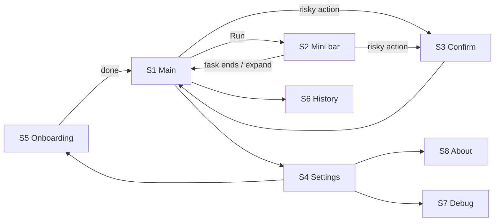

# Desktop Pilot — UI/UX Design

| Field | Value |
|---|---|
| Status | Draft v0.1, awaiting approval |
| Date | 2026-11-16 |
| Related | [PRD](PRD.md) (FR-50…56) · [SECURITY](SECURITY.md) · [ADR-001](adr/ADR-001-gui-framework.md) |

---

## 1. Design principles

1. **The user is always in control.** STOP is visible on every screen that exists while a task runs (main window, mini bar, confirmation dialog, tray menu), and it is the largest, reddest control in each.
2. **Show, don't hide.** Every action the agent takes is visible: a log line in plain words, and a marker on the screenshot preview where it clicked.
3. **Clarity over cleverness.** Plain language ("Click the **Send** button in Mail") instead of raw JSON. Raw details are one click away (expand a log line).
4. **Calm by default, loud when it matters.** Neutral palette; color is reserved for state (running, waiting for you, stopped, error) and danger.
5. **Native feel.** Follow each OS's shortcuts (Cmd vs Ctrl), menu conventions and tray/menu-bar placement.
6. **Accessible.** Everything works by keyboard and with a screen reader.

## 2. Screen inventory

| # | Screen | When | Notes |
|---|---|---|---|
| S1 | Main window | Default | Prompt, controls, log, preview, status bar |
| S2 | Mini bar | While a task runs (auto) or on demand | Always on top, compact |
| S3 | Confirmation dialog | Agent in AwaitingConfirmation | Modal over main window; also raises if mini mode |
| S4 | Settings | Gear button / Ctrl+, / Cmd+, | Tabs |
| S5 | Permission onboarding wizard | First run, missing permission, Settings ▸ Permissions | Per-OS steps |
| S6 | Session history | History button / Ctrl+H | List + detail |
| S7 | Debug panel | Settings ▸ Advanced ▸ Debug panel, or Ctrl+Shift+D | Manual action tester (M2), raw events, rate limits |
| S8 | About / Capabilities | Settings ▸ About | Capability matrix |



## 3. Wireframes

### 3.1 S1 — Main window (default 960×680, min 720×520)

```
┌────────────────────────────────────────────────────────────────────────────┐
│ Desktop Pilot                         [History] [⚙ Settings]   ─  □  ✕    │
├────────────────────────────────────────────────────────────────────────────┤
│ ┌──────────────────────────────────────────────────────────┐  Model       │
│ │ Open Spotify and play my liked songs                     │  [Sonnet 5.5 ▾]│
│ │                                                          │              │
│ │                                         Ctrl+Enter to run│  [▶ Run     ]│
│ └──────────────────────────────────────────────────────────┘  [⏸ Pause   ]│
│                                                               ┏━━━━━━━━━━┓ │
│ Confirm: Ask for risky ▾   Monitor: 1 (2560×1440) ▾           ┃ ■ STOP   ┃ │
│                                                               ┗━━━━━━━━━━┛ │
├───────────────────────────────────────┬────────────────────────────────────┤
│ Activity                    [⌄ all]   │ Last screenshot          step 4    │
│ ───────────────────────────────────── │ ┌────────────────────────────────┐ │
│ 10:02:11 You: Open Spotify and play…  │ │                                │ │
│ 10:02:12 📷 Screenshot (1280×720)     │ │      [ app screenshot ]        │ │
│ 10:02:14 💭 Spotify isn't open; I'll  │ │                                │ │
│          launch it.                   │ │              ⊕ ← click marker  │ │
│ 10:02:14 🚀 launch_app "Spotify" ✓    │ │                                │ │
│ 10:02:17 🖱 Click "Liked Songs"       │ └────────────────────────────────┘ │
│          at (212, 388) ✓          [▸] │ ◂ prev   step 4 / 4   next ▸       │
│ 10:02:19 🖱 Double-click first track  │ [⤢ open full size]                 │
│ 10:02:20 ✔ Done: Playing Liked Songs. │                                    │
├───────────────────────────────────────┴────────────────────────────────────┤
│ ● Completed │ Steps 4/50 │ Tokens 18.2k (≈ $0.04) │ 00:09 │ Sonnet 5.5 │ ⓘ │
└────────────────────────────────────────────────────────────────────────────┘
```

Behavior:
- **Prompt box:** multi-line, grows to 6 lines then scrolls. Ctrl+Enter / Cmd+Enter runs. Placeholder: *"Describe what you want done…"*. While a task runs the box becomes **follow-up** input ("Add a follow-up… (runs after the current task)"), disabled while Acting.
- **Run** becomes **Send follow-up** after the first task in a session. A **New session** item lives in the overflow (⋯) next to the model selector and as Ctrl/Cmd+N.
- **Model selector:** lists registry models by `display_name`; shows price tier hint (`$`, `$$`, `$$$`) and a ⚠ for `cost_warning` models; disabled entries show "not available for this key".
- **STOP** is a filled red button, 120×44 px minimum, always enabled while state ∈ {Thinking, Acting, AwaitingConfirmation, Paused}; disabled (greyed but visible) when idle. Tooltip shows the hotkey.
- **Pause/Resume** toggles. Label changes; Space does not trigger it (avoids accidental pauses while typing).
- **Activity log:** virtualized list. Each entry: time, icon, one-line plain-language summary, status (✓, ✗, ⏳, ⛔). Click/Enter expands raw details (tool name, input JSON, result, duration). Filter: All / Actions / Claude / Errors. Auto-scroll pinned to bottom unless the user scrolls up (then "Jump to latest" chip appears).
- **Screenshot preview:** the last image sent to Claude, with markers for every coordinate action of the last batch (numbered ⊕ markers, drag shown as arrow). Prev/next to step through history in this session. "Open full size" opens a zoomable viewer.
- **Status bar:** state pill (color + text + icon; never color alone), steps used / max, tokens and estimated cost, elapsed time, model, ⓘ opens capability warnings (e.g. "Global hotkey unavailable on this session").

### 3.2 S2 — Mini bar (always on top, 420×56, draggable, remembers position)

```
┌──────────────────────────────────────────────────────────────┐
│ ● Acting · step 7 · 00:41   “Click 'Liked Songs'”  [⏸][⤢][■ STOP] │
└──────────────────────────────────────────────────────────────┘
```

- Appears when a task starts if "Auto-minimize while acting" is on (default on); the main window minimizes.
- Shows state pill, step, elapsed, the current action in ≤ 40 characters.
- Buttons: Pause/Resume, Expand (restore main window), **STOP** (red).
- Default position: top-center of a monitor **other than the target** if one exists; otherwise top-right corner of the target monitor, 16 px inset. Excluded from captures where supported (TRD §5.6).
- When AwaitingConfirmation, the bar turns amber, says "Waiting for your approval", and the confirmation dialog opens (main window restored).
- On Wayland the mini bar cannot be always-on-top on GNOME (no client API) → it is a normal small window; noted in capability report.

### 3.3 S3 — Confirmation dialog (modal, 720×560)

```
┌──────────────────────────────────────────────────────────────────┐
│ ⚠ Approve this action?                               step 12     │
├──────────────────────────────────────────────────────────────────┤
│ ┌──────────────────────────────────────────────────────────────┐ │
│ │                [ screenshot, dimmed ]                        │ │
│ │                     ┌──────────┐                             │ │
│ │                     │  Send ⊕  │  ← highlighted target       │ │
│ │                     └──────────┘                             │ │
│ └──────────────────────────────────────────────────────────────┘ │
│ Claude wants to:  Click the “Send” button in Mail                │
│ Why it's flagged: Sends a message to someone (SendMessage)       │
│ Claude's note:    “Sending the summary email to sam@…”           │
│ ▸ Details (tool: left_click, coordinate [812, 640])              │
│                                                                  │
│ Reject note (optional): [____________________________________]   │
│                                                                  │
│      [ Reject  (Esc) ]     [ Approve (Ctrl+Enter) ]   [■ STOP]   │
└──────────────────────────────────────────────────────────────────┘
```

- Highlight: element bounds from the accessibility tree when available (rounded rectangle, 3 px amber outline); else a 48 px circle at the click point. Drag shows start → end arrow. `type` shows the text to be typed (masked if it looks like a secret, with "show" toggle). Shell shows the full command in a monospace box.
- **Default focus is Reject**, not Approve. Approve requires Ctrl/Cmd+Enter or a click (no single-key approval, avoids approving while typing elsewhere).
- No timeout, no auto-approve.
- "Always allow this kind of action for this session" checkbox appears only for medium-risk categories, never for hard-risky ones (SECURITY §4.2).
- Batch context: if more actions follow in the batch, a line shows "Then: 2 more actions (type, key Return)" with expand.

### 3.4 S4 — Settings (tabs on the left)

```
┌───────────────┬─────────────────────────────────────────────────────┐
│ General       │ API                                                 │
│ API & Models ◀│  API key   [••••••••••••••••••••a9F2]  [Change] [Test]│
│ Agent         │  Status    ✓ Valid · 4 models available              │
│ Safety        │                                                     │
│ Screen        │ Models                                              │
│ Hotkeys       │  ┌─────────────────────┬────────┬────────┬───────┐  │
│ Tools         │  │ Model               │ Effort │ Max tok│Default│  │
│ Privacy       │  │ Claude Sonnet 5.5   │ medium │ 32000  │  (•)  │  │
│ Permissions   │  │ Claude Opus 5.5     │ medium │ 32000  │  ( )  │  │
│ Advanced      │  │ Claude Haiku 5.5    │ medium │ 32000  │  ( )  │  │
│ About         │  │ Claude Fable 5.2 ⚠  │ high   │ 32000  │  ( )  │  │
│               │  └─────────────────────┴────────┴────────┴───────┘  │
│               │  [Open config file]  (add models in [[models]])     │
└───────────────┴─────────────────────────────────────────────────────┘
```

| Tab | Controls |
|---|---|
| General | Theme (System/Light/Dark), Language, Start minimized to tray, Auto-minimize while acting, Always on top (main window), Launch at login (Could) |
| API & Models | API key (masked, Change, Test, Remove), model table (effort, max tokens, default), open config file |
| Agent | Max steps (1–200, default 50), Task timeout (1–120 min, default 15), Token budget per task (default 400k), Action delay (0–2000 ms, default 150), Pause idle limit (default 10 min) |
| Safety | Confirmation mode (radio: Ask every action / Ask for risky actions (default) / Fully automatic + warning), Fail-safe corner (Off / Top-left (default) / any corner), list of risk categories with "always ask" toggles (hard-risky ones locked on) |
| Screen | Target monitor (list with thumbnails; "Monitor under cursor at start"), Screenshot size (1024 / 1280 (default) / 1366 / 1920 long edge), Image format (Auto / PNG / JPEG) |
| Hotkeys | STOP (default Ctrl+Alt+Esc / ⌃⌥⎋), Pause/Resume (Ctrl+Alt+P / ⌃⌥P), Show window (Ctrl+Alt+Space / ⌃⌥Space). Record-a-shortcut field; conflict warning. On Wayland: "Bind via system dialog" button (GlobalShortcuts portal). |
| Tools | Toggle each custom tool; Shell tool (off by default, with warning text), shell timeout, output cap; app catalog "Refresh now" |
| Privacy | Save screenshots locally (off), History retention (7/30/90 days/forever), Log clipboard contents (off), Local telemetry (off), "Delete all history" |
| Permissions | Status list per permission with ✓/✗ and "Fix" (opens S5 at that step) |
| Advanced | Log level, Open logs folder, Debug panel, Proxy (read from env, display only), Reset settings |
| About | Version, update channel, check for updates, **Capabilities matrix**, licenses |

All changes apply immediately and are saved (debounced 500 ms). Settings that cannot change mid-task (target monitor, tools) show "applies to the next session".

### 3.5 S5 — Permission onboarding wizard

macOS:

```
┌───────────────────────────────────────────────────────────┐
│ Welcome to Desktop Pilot                       Step 2 of 4 │
│ ───────────────────────────────────────────────────────── │
│ ① API key ✓   ② Accessibility   ③ Screen Recording   ④ Test │
│                                                           │
│ Allow Desktop Pilot to control your computer              │
│ Desktop Pilot needs Accessibility access to move the      │
│ mouse and type for you. It only acts while a task runs,   │
│ and you can stop it any time with ⌃⌥⎋.                    │
│                                                           │
│   [ Open System Settings ]   Status: ✗ Not allowed yet    │
│   (Privacy & Security ▸ Accessibility ▸ Desktop Pilot ✓)   │
│                                                           │
│                    [ Back ]          [ Continue ] (disabled)│
└───────────────────────────────────────────────────────────┘
```

| OS | Steps |
|---|---|
| macOS | API key → Accessibility → Screen Recording (→ Restart if required) → Test (capture preview + move pointer to a target dot, with user consent) |
| Windows | API key → Notes: "Desktop Pilot can't control windows running as administrator unless started as administrator", SmartScreen note for unsigned beta builds → Test |
| Linux X11 | API key → Accessibility bus check (offer to enable AT-SPI) → Test |
| Linux Wayland | API key → "Screen sharing & remote control" explanation → Trigger portal dialog (shows what the system dialog will look like) → GlobalShortcuts binding (or explain fallback) → Test. If portal missing: show distro-specific install hint (e.g. `xdg-desktop-portal-gnome`, `xdg-desktop-portal-kde`) and ydotool fallback guide |

Status polls every 1 s while the wizard is open. Each step has "Why is this needed?" expandable text and "Skip for now" (Run stays disabled until required ones are done).

### 3.6 S6 — Session history

```
┌──────────────────────────────┬─────────────────────────────────────────┐
│ 🔍 Search prompts…           │ Open Spotify and play my liked songs    │
│ ──────────────────────────── │ Today 10:02 · Sonnet 5.5 · ✔ Completed  │
│ ✔ Open Spotify and play…  9s │ 4 steps · 18.2k tokens · ≈ $0.04 · 9 s  │
│ ⛔ Rename all photos in…  1m │ ─────────────────────────────────────── │
│ ✗ Book a table at…       2m │ [log, same component as main window]    │
│ ✔ Make text bigger       31s│                                         │
│                              │ [Export ▾] [Delete] [Run again]         │
└──────────────────────────────┴─────────────────────────────────────────┘
```

Outcome icons: ✔ Completed, ⛔ Stopped, ✗ Error, ⏱ Limit reached. "Run again" copies the prompt into the main prompt box (does not auto-run).

### 3.7 S7 — Debug panel (developer)

Tabs: **Actions** (manual tester: pick monitor, capture, click on the preview to send `left_click` at that point, type text, key combo; shows mapped coordinates in every space), **Events** (raw AgentEvents, SSE events with bodies redacted), **Limits** (rate-limit headers, token usage per request, cache hits), **Capabilities**.

## 4. Visual style

### 4.1 Color tokens

| Token | Light | Dark | Use |
|---|---|---|---|
| `bg` | `#FFFFFF` | `#16181D` | Window background |
| `surface` | `#F5F6F8` | `#1E2128` | Panels, log |
| `surface-2` | `#EBEDF0` | `#272B33` | Inputs, hover |
| `border` | `#D5D9E0` | `#3A3F4A` | Dividers |
| `text` | `#1B1F24` | `#E8EAED` | Primary text |
| `text-muted` | `#5B6370` | `#A0A7B4` | Secondary text (≥ 4.5:1 on `surface`) |
| `accent` | `#2F5BD3` | `#7EA2FF` | Run button, focus ring, links |
| `danger` | `#C62828` | `#EF5350` | STOP, errors |
| `danger-fg` | `#FFFFFF` | `#16181D` | Text on danger |
| `warning` | `#B26A00` | `#FFB74D` | AwaitingConfirmation, risky highlight |
| `success` | `#2E7D32` | `#81C784` | Completed |
| `info` | `#0277BD` | `#4FC3F7` | Thinking |

State pills: Idle (`text-muted`), Thinking (`info`, spinner), Acting (`accent`, pulsing dot respecting reduced-motion), AwaitingConfirmation (`warning`), Paused (`text-muted`, ⏸), Stopped (`danger`, ⛔), Completed (`success`, ✔), Error (`danger`, ✗). All contrast pairs are checked to WCAG 2.2 AA (4.5:1 text, 3:1 UI components) in a unit test that reads the token table.

### 4.2 Typography

- UI font: **Inter** (embedded, OFL) for consistent rendering across OSes; fallback to egui default. Monospace: **JetBrains Mono** (OFL) for JSON, commands, coordinates.
- Scale (px at 1.0 UI scale): 12 caption, 13 body-small (log), 14 body, 16 subtitle, 20 title. Line height 1.4.
- Respect the OS text-scale setting via egui `pixels_per_point`; additional "UI scale" in Settings ▸ General (80–200%).

### 4.3 Spacing and shape

- 4 px base grid: 4, 8, 12, 16, 24, 32.
- Radius: 6 px controls, 10 px panels/dialogs.
- Minimum hit target 32×32 px (STOP 120×44).

### 4.4 Icons

Phosphor icon set (MIT) embedded via `egui-phosphor`, always paired with a text label or tooltip and an accessible name. App icon: a cursor arrow inside a rounded square "cockpit" outline, single color + accent; tray icon variants for idle / running / waiting / stopped.

## 5. Interaction details

### 5.1 Keyboard shortcuts

| Action | Windows / Linux | macOS | Scope |
|---|---|---|---|
| Run / send follow-up | Ctrl+Enter | ⌘↩ | Prompt focused |
| New session | Ctrl+N | ⌘N | App |
| **FORCE STOP** | **Ctrl+Alt+Esc** | **⌃⌥⎋** | **Global** (+ Esc twice in-app) |
| Pause / Resume | Ctrl+Alt+P | ⌃⌥P | Global |
| Show / hide window | Ctrl+Alt+Space | ⌃⌥Space | Global |
| Approve (dialog) | Ctrl+Enter | ⌘↩ | Dialog |
| Reject (dialog) | Esc | Esc | Dialog |
| Settings | Ctrl+, | ⌘, | App |
| History | Ctrl+H | ⌘Y | App |
| Debug panel | Ctrl+Shift+D | ⌘⇧D | App |
| Focus prompt | Ctrl+L | ⌘L | App |

In-app STOP: pressing Esc twice within 500 ms while a task runs stops it (single Esc is reserved for closing dialogs).

### 5.2 Focus behavior

- On launch, focus is in the prompt box.
- When a task starts, Desktop Pilot gives up focus (minimizes / shows mini bar) **before** the first action, so keystrokes go to the target app. The agent waits 300 ms after minimizing so the previous foreground window regains focus.
- The mini bar is created as a non-activating window (Windows `WS_EX_NOACTIVATE`, macOS non-activating panel, X11 `_NET_WM_WINDOW_TYPE_DOCK`/utility hint) so clicking STOP does not steal focus from the target app.
- When the task ends, the main window is restored but **not focused** if the user is typing in another app (only flashes the taskbar / bounces dock once). Configurable.
- Confirmation dialog takes focus (it must) and returns focus to the previous app on Approve before executing the action (the agent re-focuses via `focus_window` when supported, otherwise via the mini bar non-activation + 300 ms delay).

### 5.3 Auto-minimize and own-window exclusion

- "Auto-minimize while acting" default on. If off, the main window stays visible but is excluded from captures where supported; on X11/Wayland the agent warns that the window may cover target apps.
- Screenshot previews and click markers are drawn inside our window only — never as overlays on the real desktop in v1 (an overlay would be captured and confuse the model). v1.x Could: transparent click-through overlay excluded from capture on Windows/macOS.

### 5.4 Feedback timings

- Action delay default 150 ms after each action, so humans can follow.
- Spinner appears only after 300 ms of waiting (avoids flicker).
- Retry countdown visible in the log: "Rate limited — retrying in 12 s [Stop]".

## 6. Accessibility of the app itself

- egui's **AccessKit** integration is enabled: every widget has a role and an accessible name (e.g. STOP button name "Force stop agent", description "Shortcut Control Alt Escape").
- Log entries are exposed as a list; new entries are announced politely (`aria-live=polite` equivalent) but at most one announcement per second; errors and "Waiting for approval" are announced assertively.
- Full keyboard navigation with visible 2 px focus ring (`accent`). Tab order: prompt → model → run → pause → stop → log → preview → settings.
- Reduced motion: no pulsing/spinners when the OS reduced-motion setting is on (where detectable) or the in-app toggle is on.
- High contrast: a High Contrast theme variant with pure black/white and thicker borders; follows Windows high-contrast mode.
- No information by color alone: state pills have icon + text.
- Screen-reader caveat: while the agent controls the computer, screen readers will also announce target-app changes; the onboarding explains this.

## 7. Platform conventions

| Topic | Windows | macOS | Linux |
|---|---|---|---|
| Modifier in UI text | Ctrl | ⌘ / ⌃ symbols | Ctrl |
| Menus | No menu bar; overflow ⋯ menu | Native app menu bar via `muda`: Desktop Pilot (About, Settings…, Quit), Edit (copy/paste for text fields), Session (New, Stop, Pause), Window, Help | No menu bar; overflow ⋯ menu |
| Tray / menu bar icon | Notification area icon: Show, Stop, Pause, Quit | Menu-bar extra with the same items (template image) | StatusNotifierItem (KDE native; GNOME needs AppIndicator extension → fallback: none, noted in capabilities) |
| Close button | Closes window to tray if tray enabled, else quits (asks if task running) | Closes window; app keeps running in menu bar; ⌘Q quits | Same as Windows |
| Dialog button order | Approve … Reject (OK left) | Reject … Approve (default right) | GNOME: Reject … Approve; KDE: Approve … Reject — follow desktop env |
| Window chrome | Native | Native title bar | Native (client-side decorations on GNOME Wayland via winit) |

---

## Assumptions

1. egui/eframe with AccessKit exposes enough semantics for NVDA, VoiceOver and Orca to read all controls (verify in M1).
2. Inter and JetBrains Mono embedded fonts add ≈ 1 MB, acceptable for the size budget.
3. A non-activating mini bar is achievable through `winit` window attributes or small `platform-*` helpers.
4. Users accept the main window minimizing during tasks by default.

## Open questions

1. Do you have brand guidelines (name, logo, colors), or should the palette above be the brand?
2. Should we embed Inter/JetBrains Mono or use system fonts (Segoe UI / SF Pro / Cantarell-Noto) for a more native look?
3. Is "Esc twice" as an in-app stop acceptable, or should single Esc stop when no dialog is open?
4. Should the confirmation dialog also allow **editing** the proposed action (e.g. change typed text) in v1, or only approve/reject?
5. History shortcut on macOS: ⌘Y (Safari convention) or ⌘H (conflicts with Hide)? Proposed ⌘Y.
