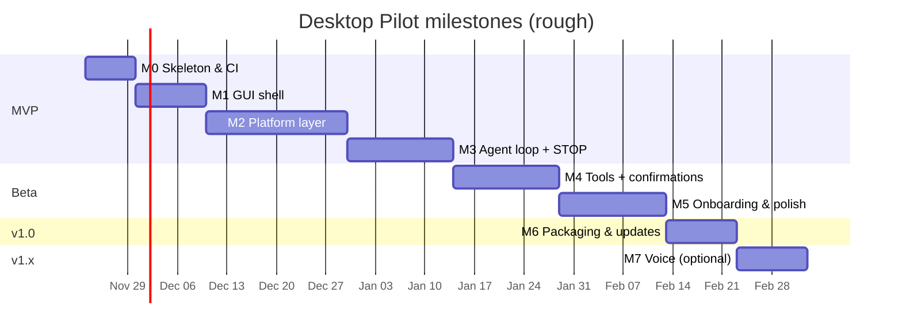

# Desktop Pilot — Roadmap

| Field | Value |
|---|---|
| Status | Approved 2026-11-16; Windows 11 prioritized (see Progress) |
| Date | 2026-11-16 |
| Related | [PRD §10 Release plan](PRD.md) · [TEST_PLAN](TEST_PLAN.md) |

## Progress

| Date | Item | State |
|---|---|---|
| 2026-11-16 | M0 workspace skeleton, CI, docs | Done locally (CI not yet run: no GitHub repo) |
| 2026-11-16 | **Product owner re-prioritized: Windows 11 first** (answers ROADMAP open question 3). Pulled forward a Windows slice: small eframe window (M1 subset: prompt box, model selector, STOP, log, status bar) + real mouse input and monitor enumeration on Windows (M2 subset), with a mouse test panel, cancellable smooth motion and user-takeover detection. | Done on Windows 11; macOS/Linux build only |
| — | MSRV raised 1.85 → 1.95 (latest eframe 0.37 needs it; TRD §1) | Done |
| 2026-11-16 | **Windows agent preview** (product owner: "enable all features"): settings in TOML, API key in Credential Manager, credentials from env / saved key / `ant` CLI login; keyboard input, GDI screen capture, coordinate mapping with property-style tests; Claude client (SSE streaming, retries, 401 token refresh); agent loop with all 17 computer-toolset actions, batch rule, approval before each action (default) or automatic mode, Pause, STOP via button/Esc/Ctrl+Alt+Esc/corner fail-safe, compact always-on-top bar, follow-ups and New session. | Built and unit-tested on Windows 11; **not yet run against the real API** (no credentials on the dev machine) |
| 2026-11-16 | Live check: `ant` login works (models endpoint OK); Messages API refused with "credit balance is too low" (no Console credit). Added `--test-connection` and a plain-language error banner in the GUI. | Done |
| 2026-11-16 | **MCP server mode** (`desktop-pilot --mcp`), so the product owner can use their Claude Pro plan through Claude Code instead of API credit: 17 computer-use tools over stdio JSON-RPC, same executor as the agent, STOP hotkey + corner fail-safe with a 30 s refusal window. Tested end to end over stdio (initialize, tools/list, real screenshot, cursor, bounds check). | Done; registering in Claude Code is left to the user |
| next | First live agent run (needs Console credit) or first Claude Code run via MCP | Planned |
| next | M4 on Windows: `launch_app`, window tools, clipboard, UI tree, risk classifier ("ask for risky actions" mode) | Planned |
| next | M5 polish: monitor selection, session history, onboarding | Planned |

Every milestone ends with the same **standard exit criteria** (from the engineering rules):

1. CI green on Windows, macOS and Linux (all jobs in [TEST_PLAN §4.1](TEST_PLAN.md) that exist at that milestone).
2. All tests pass; new code has tests at the levels the TEST_PLAN prescribes.
3. `clippy -D warnings` and `rustfmt` clean.
4. README updated (features, setup, known limitations).
5. A **demo checklist** (below, per milestone) that the product owner can run in ≤ 15 minutes per OS.
6. Changelog entry; open issues triaged.

Estimates assume one experienced Rust engineer full time with AI assistance; they are rough and get re-estimated at the end of each milestone.

---

## M0 — Workspace skeleton, CI, docs (≈ 1 week)

**Scope**
- Cargo workspace with all crates from [ARCHITECTURE §2](ARCHITECTURE.md) as compiling stubs (traits declared in `platform`, empty impls in `platform-*`).
- Shared `[workspace.package]` (edition 2021, `rust-version = "1.85"`, license), `[workspace.lints]`, `[workspace.dependencies]` with the latest stable versions of the TRD crates, each checked against its current docs.
- `rust-toolchain.toml`, `rustfmt.toml`, `clippy.toml`, `deny.toml`.
- GitHub Actions: `lint`, `test-windows`, `test-macos-arm`, `test-linux-x11`, `msrv`; `test-linux-wayland` job prototype (allowed to fail until M2).
- Dependency-rule script (no OS crates outside `platform-*`).
- `README.md` (project intro, build steps), `CONTRIBUTING.md`, `LICENSE`, root `SECURITY.md` (reporting).
- Docs from Phase A committed; ADRs marked Accepted after your approval.

**Deliverables:** repo builds on all three OSes; `desktop-pilot --version` prints version and detected platform/session type.

**Definition of done:** standard exit criteria; CI badge green; `cargo deny` clean.

**Demo checklist**
- [ ] Clone, `cargo run -p desktop-pilot -- --version` on each OS prints version + `os=… session=…`.
- [ ] Open a PR with a clippy warning → CI fails; fix → CI passes.

---

## M1 — GUI shell (≈ 2 weeks)

**Scope**
- eframe app with main window layout (prompt, model selector, Run, Pause, STOP, log panel, preview panel, status bar) using fake data from a `DemoAgent`.
- Settings window (all tabs present; General, API & Models, Agent, Safety, Screen, Privacy functional).
- `config` crate: TOML load/save/migrate, model registry with the four default models, `--print-paths`.
- `SecretStore` implementations via `keyring` on all OSes; API key entry, masking, "Test key" (`GET /v1/models` through a minimal `llm` client).
- Theme tokens (light/dark), Inter/JetBrains Mono, AccessKit labels, keyboard navigation.
- Tracing setup with masking layer + rolling file logs; panic hook (stub `release_all`).
- Fluent localization scaffold (English).

**Deliverables:** runnable GUI that stores the key securely and lists models from config.

**Definition of done:** standard exit criteria; unit tests for config, registry, masking; snapshot test of the default config; manual a11y check with one screen reader per OS.

**Demo checklist**
- [ ] Enter API key → Test → "Valid, N models available". Restart → key still there; config file has no key.
- [ ] Add a fake `[[models]]` entry → appears in the dropdown after restart.
- [ ] Toggle dark/light; navigate everything with Tab/Shift+Tab; screen reader reads the STOP button.
- [ ] `grep -r sk-ant` over the config and log dirs → no match.

---

## M2 — Platform layer: screenshots + input on all OSes (≈ 4 weeks)

**Scope**
- `ScreenCapture`, `InputController` (with held-input tracking and `release_all`), monitor enumeration on Windows, macOS, X11 and Wayland (portal ScreenCast + RemoteDesktop via `ashpd` + PipeWire; libei where available; ydotool fallback).
- `core::coords` with full unit + property tests; DPI awareness (Windows manifest), Retina, Xft, fractional scaling.
- Own-window exclusion/hiding per OS.
- `PermissionManager` basics (macOS checks/requests, Wayland portal session + restore token).
- Capability report.
- **Debug panel (Actions tab):** pick monitor, capture, click on the preview to inject a click, type text, send key combos, show coordinates in every space.
- Platform smoke tests in CI (Windows, X11, Wayland headless; macOS on self-hosted if available).

**Deliverables:** manual control of the desktop through the debug panel on every supported platform.

**Definition of done:** standard exit criteria; platform smoke tests green; manual HiDPI checks (TEST_PLAN §5.2 scaling items) pass on each OS; ADR-002 updated with findings.

**Demo checklist**
- [ ] On each OS: open debug panel → Capture → preview shows the selected monitor without the app's own window.
- [ ] Click on a button in the preview → the real button is clicked (±2 px) at 100% and at 150%/200%/Retina.
- [ ] Type "Grüße 🙂" into a text editor via the panel.
- [ ] Press and hold Shift via the panel, then press "Release all" → Shift released.
- [ ] Wayland: consent dialog once; restart → no dialog (if backend supports restore).

---

## M3 — Claude agent loop with computer use, streaming log, FORCE STOP (≈ 3 weeks)

**Scope**
- Re-verify API facts (TRD §3.1) against platform.claude.com; update ADR-004 if anything changed.
- `llm`: request builder per model profile, SSE parser, retries/backoff, error mapping, refusal handling, usage accounting, `input_transformations` logging.
- `core`: `Agent` runner, state machine, append-only `Session`, computer toolset executor for all 17 members (incl. zoom from last raw frame, batch failure rule), context editing + checkpoint compaction, system prompt template, limits (steps, timeout, tokens), repeated-action detector.
- STOP: button, global hotkey (`global-hotkey`; Wayland GlobalShortcuts portal or fallback), corner fail-safe; Pause/Resume.
- UI: live streaming log with progress notes, screenshot preview with click markers, status bar with tokens/cost/time.
- Confirmation mode "Ask every action" only (full risk system in M4).
- Mock Claude server + integration tests IT-01…IT-03, IT-07…IT-17; stop-latency harness.

**Deliverables:** MVP: a user can run natural-language tasks end-to-end on all OSes and stop them instantly.

**Definition of done:** standard exit criteria; stop latency p99 ≤ 100 ms on Windows, macOS, X11 (Wayland measured and reported); benchmarks B1, B2, B4 pass on each OS at least 2/3 runs.

**Demo checklist**
- [ ] "Open the calculator and compute 12*34" → result 408; log shows each step; preview shows click markers.
- [ ] Start "Type the alphabet 20 times in a text editor" → press hotkey → typing stops at once; no stuck keys.
- [ ] Same with corner fail-safe (not Wayland) and STOP button.
- [ ] Pause mid-task, wait, Resume → continues.
- [ ] Switch model between two prompts → status bar shows the new model.
- [ ] Disconnect network → retry countdown → Stop during countdown works.

---

## M4 — Custom tools, confirmation system, risk classifier (≈ 3 weeks)

**Scope**
- `tools`: `list_installed_apps` (cached), `launch_app` (fuzzy), `list_open_windows`, `focus_window`, `get_ui_tree` (pruned, size-limited, bounds in model space), `read_clipboard`, `write_clipboard`, `run_shell_command` (off by default).
- `AppCatalog`, `WindowManager`, `AccessibilityTree`, `Clipboard` implementations per OS with graceful degradation.
- `RiskClassifier` with rules file + corpus; element-at-point lookup; three confirmation modes; confirmation dialog (S3); "always allow for session" for Medium categories.
- Untrusted-content wrapping, appended system messages after approvals/rejections.
- Integration tests IT-04…IT-06, IT-18, IT-19; risk corpus tests.

**Deliverables:** agent uses apps/windows/UI tree for precise targeting; risky actions are gated.

**Definition of done:** standard exit criteria; risk corpus: 0 Hard false negatives; benchmarks B1–B10 at ≥ 70% per OS; B10–B12 safe 100%.

**Demo checklist**
- [ ] "Open Spotify" (or another installed app) by a partial/misspelled name → launches correct app.
- [ ] "Bring the Budget window to front" → focused (GNOME Wayland: graceful message + Alt+Tab fallback).
- [ ] "Send an email to test@… saying hi" → confirmation dialog highlights Send; Reject → not sent.
- [ ] Enable shell tool → "list files in Downloads" → confirmation with full command → output in log.
- [ ] Injection page (B11) → agent does not follow on-page instructions.

---

## M5 — Onboarding, mini mode, multi-monitor, HiDPI polish, session history (≈ 3 weeks)

**Scope**
- Permission onboarding wizard (S5) for all OSes, including restart flow on macOS and portal flow on Wayland; Settings ▸ Permissions.
- Mini bar (S2): non-activating, always on top where possible, excluded from capture, positioned off target monitor.
- Multi-monitor selection UI, display-change handling, mixed-DPI polish.
- Session history (S6) with retention and delete; optional screenshot saving.
- Tray / menu-bar icon and macOS app menu.
- Capability matrix in About; full Settings (Hotkeys, Tools, Advanced).
- Accessibility pass (screen readers, high contrast, reduced motion).

**Deliverables:** Beta-quality UX on all platforms.

**Definition of done:** standard exit criteria; full manual checklist (TEST_PLAN §5) passes on each OS; first-run-to-first-task ≤ 5 min with 3 test users per OS; benchmarks ≥ 80%.

**Demo checklist**
- [ ] Fresh macOS user account → onboarding → first task done without reading docs.
- [ ] Fresh GNOME Wayland session → portal consent → first task done.
- [ ] Run a task with two monitors; agent works on the selected one; mini bar sits on the other.
- [ ] History shows the last tasks; delete one; "Delete all" clears data dir.

---

## M6 — Packaging, signing, notarization, auto-update (≈ 2 weeks)

**Scope**
- Windows MSI (x64, ARM64) via `cargo-wix`, Authenticode signing in CI.
- macOS `.app` + `.dmg`, hardened runtime, Developer ID signing, `notarytool` + stapling in CI.
- Linux AppImage, `.deb`, `.rpm`; optional Flatpak manifest (with portal permissions).
- Auto-update: ADR for updater crate; signed manifest; update check in About (opt-out), no silent install without consent.
- SBOM, checksums, release notes automation; README install sections per OS.

**Deliverables:** v1.0 release candidates.

**Definition of done:** standard exit criteria; installers install/uninstall cleanly on fresh VMs; macOS Gatekeeper passes without warnings; Windows SmartScreen reputation plan documented; benchmark gate ≥ 85% (PRD §9); all PRD v1.0 metrics measured.

**Demo checklist**
- [ ] Download each installer from the draft GitHub release, install on a clean VM, run B1.
- [ ] Publish a test update → app offers it → installs → version bumped; tampered manifest rejected.

---

## M7 (optional) — Voice input (≈ 2 weeks)

**Scope**
- Push-to-talk button and hotkey; audio capture via `cpal`.
- Local transcription with `whisper-rs` (model downloaded on demand, size choice in Settings) **or** a speech-to-text API (decision ADR; local preferred for privacy).
- Transcript lands in the prompt box for review (no auto-run by default).
- Microphone permission handling (macOS `NSMicrophoneUsageDescription`, Flatpak/portal).

**Deliverables:** voice-to-prompt on all OSes.

**Definition of done:** standard exit criteria; WER sanity check on 20 sample prompts per language supported; CPU/RAM budgets documented for each model size.

**Demo checklist**
- [ ] Hold the PTT hotkey, say "open the calculator and compute twelve times thirty-four" → transcript appears → Run → 408.

---

## Assumptions

1. Phase A approval happens before 2026-11-23 (gantt dates shift otherwise).
2. Code-signing identities (Apple Developer ID, Windows certificate) are available by M6.
3. Self-hosted macOS runner is available from M2 for full platform tests; otherwise those remain manual.
4. One engineer full time; parallel work (e.g. platform crates per OS) can shorten M2.

## Open questions

1. Is the overall timeline (~16 weeks to v1.0) in line with your expectations, or is there a hard date?
2. Should M2 be split per OS (M2a Windows/macOS, M2b Linux X11/Wayland) to get the MVP loop working on one OS earlier?
3. Do you want an intermediate "Windows-only MVP" release, or keep strict equal priority across OSes for every milestone?
4. Voice (M7): local `whisper-rs` vs. a cloud speech-to-text API — any preference?
